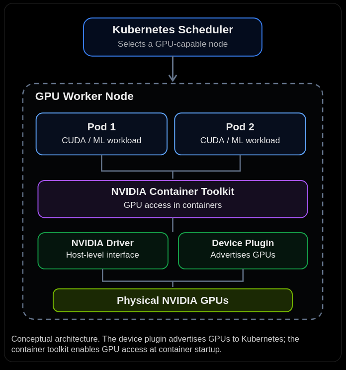
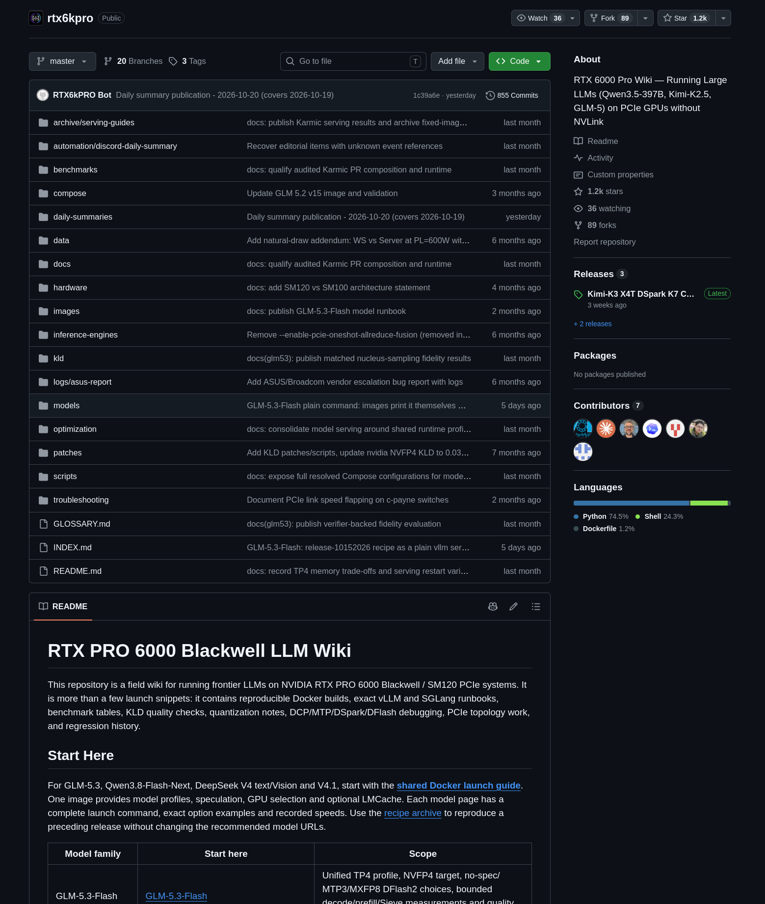
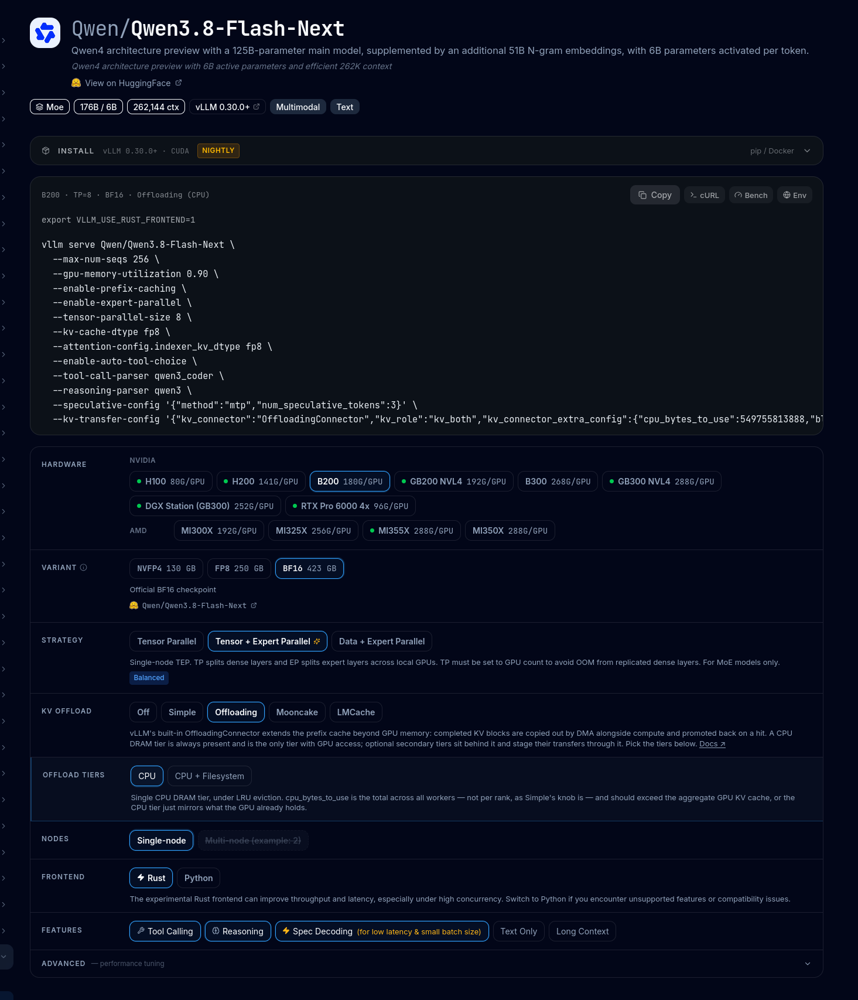
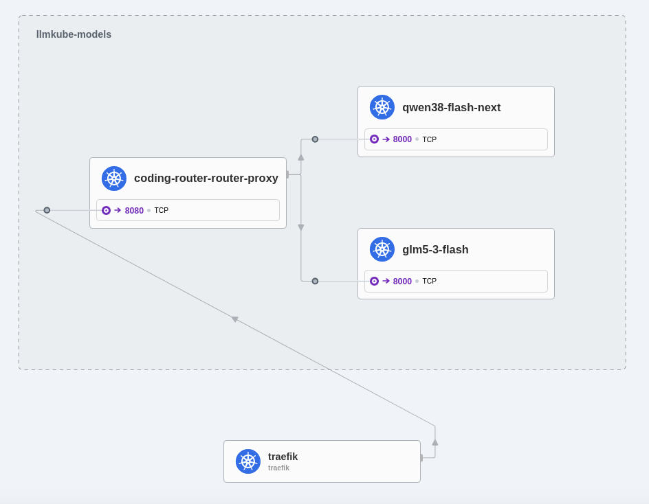
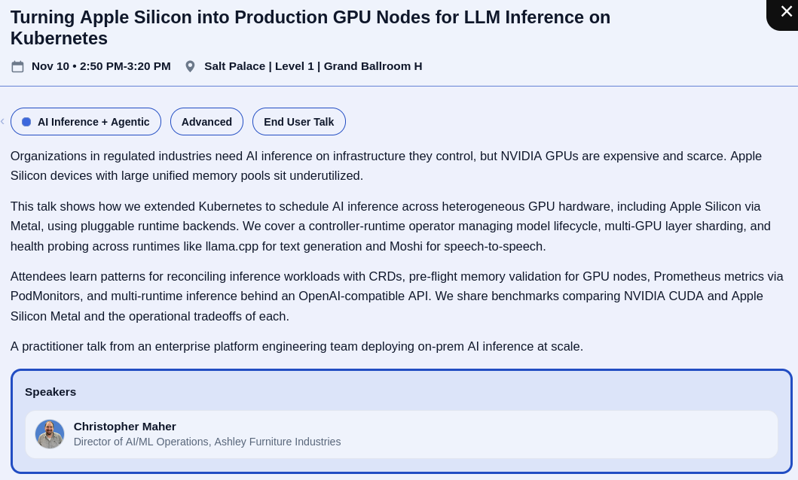

What and why?
---

- Agentic coding is everywhere
- Open models are getting really good
- API price predictability
- Do you actually own the code / data / model using public offerings?
- Soveringity

<!-- end_slide -->

WHOAMI
---

- Infra at Clausal
- Cloud Native Finland ry
- Cloud Native Finland Events Oy
- K8s enjoyer since 1.9
- Cyber as a hobby
- Brew beer and make pizzas

<!-- end_slide -->

I own a at least one flamethrower
---


<!-- end_slide -->

What does it take to run a model in a cluster?
---

- Kubernetes does not know what a GPU is, the container runtime needs to know how to expose a device to the container

<!-- pause -->

- runtimeClass: nvidia
- <https://github.com/NVIDIA/k8s-device-plugin>

<!-- pause -->

With the _nvidia_ runtimeClass specified, the CRI takes care of:

- Exposing allocated GPU device nodes, such as /dev/nvidia0 and /dev/nvidiactl, inside the container.
- Make compatible host NVIDIA driver libraries available
- Configuring the hooks and environment required for CUDA-based applications
- Apply NVIDIA Container Toolkit device visibility and capability settings


<!-- end_slide -->

Container Device Interface
---

- standard way for device vendors to tell the CRI how to make the device consumable by the container
- removes the need for container runtime specific plugins
- NVIDIA operator provides this, and much more
  - <https://github.com/NVIDIA/gpu-operator/>

<!-- end_slide -->
<!-- jump_to_middle -->

Example vLLM deployemt
---

<!-- end_slide -->

Example vLLM deployment
---

```yaml
apiVersion: apps/v1
kind: Deployment
metadata:
  name: qwen38-flash-next
  namespace: alt-vllm
  labels:
    app: qwen38-flash-next
spec:
  replicas: 1
  revisionHistoryLimit: 3
  strategy:
    type: RollingUpdate
    rollingUpdate: { maxSurge: 1, maxUnavailable: 0 }
  selector:
    matchLabels: { app: qwen38-flash-next }
  template:
    metadata:
      labels: { app: qwen38-flash-next }
      annotations:
        prometheus.io/scrape: "true"
        prometheus.io/port: "8000"
        prometheus.io/path: "/metrics"
    spec:
      runtimeClassName: nvidia
      terminationGracePeriodSeconds: 60
      securityContext:
        seccompProfile: { type: RuntimeDefault }
      volumes:
        - name: hf-cache
          persistentVolumeClaim: { claimName: qwen-model-cache-pvc }
        - name: build-cache
          emptyDir: {}
        - name: shm
          emptyDir: { medium: Memory, sizeLimit: 16Gi }
      initContainers:
        - name: fetch-weights
          image: vllm/vllm-openai:latest
          command: ["hf", "download", "Qwen/Qwen3.8-Flash-Next-FP8"]
          env:
            - name: HF_TOKEN
              valueFrom: { secretKeyRef: { name: hf-token-secret, key: token } }
          resources:
            requests: { cpu: "8", memory: 32Gi }
            limits: { cpu: "16", memory: 64Gi }
          volumeMounts:
            [{ mountPath: /root/.cache/huggingface, name: hf-cache }]
      containers:
        - name: qwen38-flash-next
          image: vllm/vllm-openai:latest
          imagePullPolicy: IfNotPresent
          args:
            - Qwen/Qwen3.8-Flash-Next-FP8
            - --served-model-name
            - qwen38-flash-next
            - --tensor-parallel-size
            - "4"
            - --max-model-len
            - "262144"
            - --max-num-batched-tokens
            - "16384"
            - --gpu-memory-utilization
            - "0.92"
            - --enable-prefix-caching
            - --enable-auto-tool-choice
            - --tool-call-parser
            - qwen3_coder
            - --reasoning-parser
            - qwen3
            - --api-server-count
            - "4"
          env:
            - name: HF_TOKEN
              valueFrom: { secretKeyRef: { name: hf-token-secret, key: token } }
            - name: HF_HOME
              value: /root/.cache/huggingface
            - name: VLLM_CACHE_ROOT
              value: /root/.cache/vllm
            - name: TRITON_CACHE_DIR
              value: /root/.cache/triton
            - name: TORCHINDUCTOR_CACHE_DIR
              value: /root/.cache/inductor
            - name: VLLM_WORKER_MULTIPROC_METHOD
              value: spawn
          ports:
            - { containerPort: 8000, name: http, protocol: TCP }
          startupProbe:
            httpGet: { path: /health, port: 8000 }
            periodSeconds: 15
            failureThreshold: 180
          readinessProbe:
            httpGet: { path: /health, port: 8000 }
            periodSeconds: 10
            failureThreshold: 3
          livenessProbe:
            httpGet: { path: /health, port: 8000 }
            periodSeconds: 60
            timeoutSeconds: 10
            failureThreshold: 8
          resources:
            requests: { cpu: "48", memory: 260Gi, nvidia.com/gpu: "4" }
            limits: { cpu: "48", memory: 260Gi, nvidia.com/gpu: "4" }
          lifecycle:
            preStop: { exec: { command: ["/bin/sh", "-c", "sleep 10"] } }
          volumeMounts:
            - { mountPath: /root/.cache/huggingface, name: hf-cache }
            - { mountPath: /root/.cache/vllm, name: build-cache, subPath: vllm }
            - {
                mountPath: /root/.cache/triton,
                name: build-cache,
                subPath: triton,
              }
            - {
                mountPath: /root/.cache/inductor,
                name: build-cache,
                subPath: inductor,
              }
            - { mountPath: /dev/shm, name: shm }
```

<!-- end_slide -->

Good sources for bootstrapping: Local Inference Lab
---

[local-inference-lab on GitHub](https://github.com/local-inference-lab)

Has hardware specific setups and guides


<!-- end_slide -->

Good sources for bootstrapping: vLLM recipes
---

- [vLLM recipes](https://recipes.vllm.ai/)



<!-- end_slide -->

But what about day 2 operations?
---

- auth/authz
- Not all models and data is equal -> different models
- proprietary models
- Monitoring
- Policies and Compliance

<!-- end_slide -->

<!-- jump_to_middle -->

LLMKube
---

<!-- end_slide -->

LLMKube
---

- Fairly new project, Now 2025
  - "old" in this context
- Operated lifecycle, supports pretty much any model runtime
- GitOps "native" type of project
- all major HW vendors supported
  - NVIDIA, AMD, Apple, Intel
- OpenAI-compatible API
  "/v1/chat/completions"

<!-- end_slide -->

<!-- jump_to_middle -->

So what do you get?
---

<!-- end_slide -->

LLMKube CLI
---

```
 llmkube
LLMKube: Treating intelligence as a workload.
Scale, secure, and observe local LLMs like microservices.

Deploy and manage local LLM inference services on Kubernetes with
built-in observability, SLO enforcement, and edge-native capabilities.

Usage:
  llmkube [command]

Available Commands:
  audit       Inspect and export Foreman run audit records
  benchmark   Benchmark an LLM inference service
  cache       Manage the model cache
  catalog     Manage and browse the model catalog
  completion  Generate the autocompletion script for the specified shell
  delete      Delete an LLM deployment
  deploy      Deploy a local LLM inference service
  fleet       Manage federated edge sites
  foreman     Operate the Foreman agentic-coding harness
  help        Help about any command
  inspect     Inspect a local GGUF model file
  license     View license information for models
  list        List LLM resources
  queue       Show InferenceServices waiting for GPU resources
  scale       Scale an InferenceService deployment
  status      Show status of an LLM deployment
  version     Print version information

Flags:
  -h, --help   help for llmkube

Use "llmkube [command] --help" for more information about a command.
```

<!-- end_slide -->

CRDs
---

Model

- Where do I find model x? What hardware accelerator etc
- Fetches the model and serves it from disk to any InfrerenceService

```yaml
apiVersion: inference.llmkube.dev/v1alpha1
kind: Model
metadata:
  name: qwen38-flash-next
spec:
  source: https://huggingface.co/Qwen/Qwen3.8-Flash-Next-FP8
  format: safetensors
  quantization: fp8

  sourceSecretRef:
    name: <huggingface API token secret>
  hardware:
    accelerator: cuda
    gpu:
      enabled: true
      count: 4
      vendor: nvidia
```

<!-- end_slide -->

CRDs
---

InferenceService

- describes how to serve a model
- Deployment + Service + PodMonitor

```yaml
apiVersion: inference.llmkube.dev/v1alpha1
kind: InferenceService
metadata:
  name: coder-prod
spec:
  modelRef: qwen3-8b
  runtime: llamacpp
  replicas: 2
  priority: high
  evictionProtection: true
  contextSize: 32768
  flashAttention: true
  parallelSlots: 4
  runtimeClassName: nvidia
  resources:
    gpu: 1
    cpu: "2"
    memory: 16Gi
```

<!-- end_slide -->

So now we can run a bunch of models, what is next?
---

- Agents / consumers want a single endpoint
- The developers should not do the routing or think about cost
  - should be built into the platform so that stakeholders know what is up

<!-- end_slide -->

ModelRouter
---

```yaml
apiVersion: inference.llmkube.dev/v1alpha1
kind: ModelRouter
metadata:
  name: coding-router
spec:
  backends:
    - name: local-qwen
      tier: local
      inferenceServiceRef:
        name: qwen3-coder
    - name: cloud-opus
      tier: cloud
      external:
        provider: anthropic
        model: claude-opus-4-7
        url: https://api.anthropic.com
        credentialsSecretRef:
          name: anthropic-key

  rules:
    - name: pii-stays-local
      match:
        dataClassification: ["pii", "phi"]
      route:
        backends: ["local-qwen"]
      failClosed: true

    - name: complex-to-cloud
      match:
        taskComplexity: complex
      route:
        backends: ["cloud-opus", "local-qwen"]
        strategy: primary-fallback

  defaultRoute: local-qwen
```

<!-- end_slide -->

Overview
---


<!-- end_slide -->

KubeCon North America talk
---



<!-- end_slide -->

If you want to reach out
---

GitHub: LinAnt

Linkedin: [Anton Lindholm](https://www.linkedin.com/in/anton-lindholm-b582b514a)

<!-- end_slide -->

<!-- jump_to_middle -->

Questions?
---
